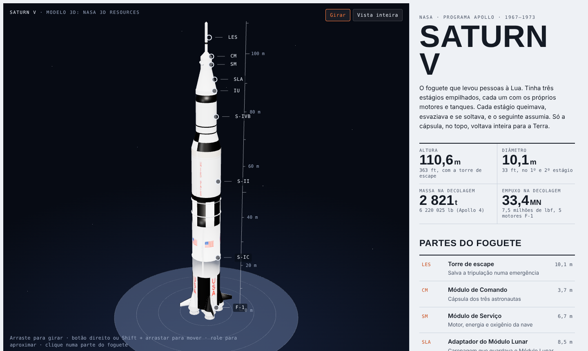

# saturn-v-3d
Interactive 3D website of NASA's Saturn V rocket

**Live site:** https://kevinscoutinho.github.io/saturn-v-3d/

This project displays NASA's official 3D model of the Saturn V, the rocket that took the Apollo crews to the Moon. Users can rotate, zoom, and pan around the rocket, and click on any of its nine main parts (from the launch escape tower down to the F-1 engines) to open an information card with a description and technical specifications. A side panel presents the rocket's key figures, a flight sequence, and a short history. The page content is written in Portuguese.

The 3D scene is built with three.js (r128), using OrbitControls for camera movement (with limits so the rocket always stays in view) and GLTFLoader to load the model. HTML labels are projected onto the 3D scene, and raycasting identifies which part of the rocket the user clicks. The layout adapts to phones, where touch gestures control the camera.

## Controls
- **Rotate:** drag (one finger on mobile)
- **Zoom:** scroll wheel (pinch on mobile)
- **Pan:** right-click drag or Shift + drag (two fingers on mobile)
- **Part details:** click a marker, the rocket itself, or an item in the side panel

## Credits
- 3D model: [NASA 3D Resources](https://github.com/nasa/NASA-3D-Resources). The texture of the first-stage band was recolored from blue to white to match the real rocket.
- Technical data: [NASA Apollo 4 Press Kit (1967)](https://ntrs.nasa.gov/api/citations/19670031260/downloads/19670031260.pdf) and the [Smithsonian National Air and Space Museum](https://airandspace.si.edu/collection-objects/rocket-engine-liquid-fuel-f-1/nasm_A19700271000).

## Running locally
The model is loaded with `fetch`, so opening `index.html` directly from disk will not work in most browsers. Serve the folder instead, for example with `python -m http.server`, and open `http://localhost:8000`.
